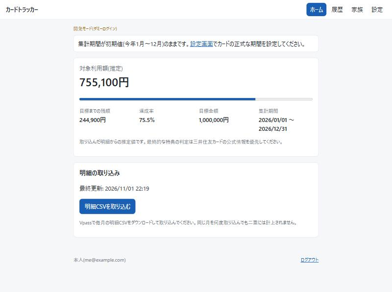
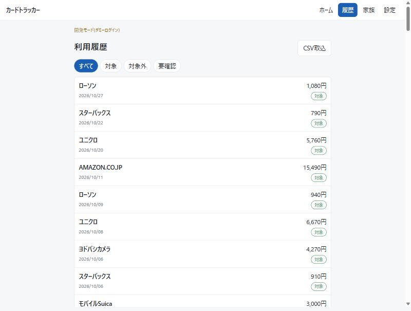
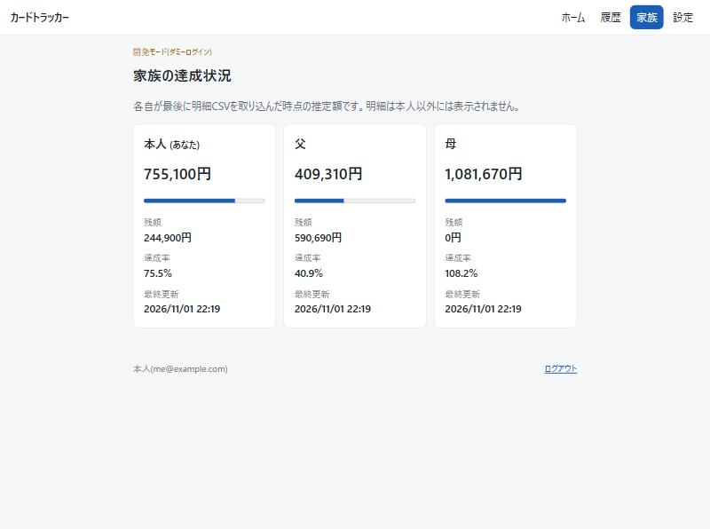

# カードトラッカー

家族3人が使う三井住友カード(NL)の「年間100万円利用」の進み具合を管理するWebアプリです。
各自がVpassで毎月ダウンロードできる**明細CSV**をアップロードすると、対象になる利用額を集計して表示します。

- 自分の画面: 対象利用額(推定)、100万円までの残額、達成率、利用履歴、判定と金額の手動修正
- 家族の画面: 全員の達成額・残額・最終更新日時だけを表示(明細は本人にしか見えない)

> 表示する金額は明細をもとにした**推定値**です。特典の最終判定は三井住友カードの公式情報を優先してください。

## このリポジトリについて

実際に家族で使っているアプリのソースコードです。個人情報と本番環境の情報は、コードとこのREADMEには載せていません。本番環境は登録済みのアカウントしかログインできないため、動作は下の「ローカルで動かす」の開発モード(ダミーログイン)で確認できます。

## 画面

開発モードで、架空の明細データを入れて撮影したものです。金額や利用先は実際のものではありません。

**ホーム**: 自分の対象利用額と、100万円までの残額・達成率



**利用履歴**: 取引ごとの自動判定(対象 / 対象外 / 要確認)。手動で修正もできる



**家族の達成状況**: 家族には集計値だけを見せ、明細は本人にしか表示しない



---

## 技術構成

| 用途 | 技術 | 選んだ理由 |
| --- | --- | --- |
| バックエンド | Python 3.14 / Flask | 処理の流れを自分で説明しやすい |
| 画面 | HTML / CSS(JavaScriptなし) | フォーム送信だけで操作が完結するので不要 |
| Googleログイン | Authlib(OAuth 2.0 / OpenID Connect) | Flaskと組み合わせやすい |
| 明細の取り込み | Python標準の `csv` | Vpassの明細CSVを読むだけなので、追加のライブラリは不要 |
| DB | SQLAlchemy + **SQLite(ローカル) / Postgres(本番)** | 下の「SQLiteから変えた理由」を参照 |
| 公開先 | Vercel + Neon Postgres | HTTPS対応、GitHubへのpushで自動デプロイ |

### SQLiteから変えた理由

Vercelのサーバーはリクエストごとに起動・破棄され、ファイルを書いても残りません。SQLiteのままでは再起動後にデータが残らないため、本番だけ Postgres(Neon)を使います。

SQLAlchemyを通しているので、アプリのコードは共通です。ローカル開発とテストはSQLiteのまま動きます。
また、Vercel上で `DATABASE_URL` が未設定のときは、データを失わないようわざと起動を止めます。

---

## ディレクトリ構成

```
card-tracker/
├─ api/index.py            Vercelの入口(app を公開するだけ)
├─ cardtracker/
│  ├─ __init__.py          アプリの組み立て・セキュリティヘッダー・初期対象外ルール
│  ├─ config.py            環境変数の読み込みとチェック
│  ├─ db.py / models.py    DB接続とテーブル定義
│  ├─ auth.py              Googleログイン、登録済みアカウント以外の拒否
│  ├─ csv_import.py        明細CSVの読み取りと取り込み(重複防止)
│  ├─ classifier.py        対象 / 対象外 / 要確認 の自動判定と再判定
│  ├─ summary.py           集計(対象利用額・残額・達成率)
│  ├─ views.py             各画面
│  ├─ security.py          CSRF対策
│  └─ templates/ static/   HTML と CSS
├─ docs/images/            READMEの画面キャプチャ
├─ tests/                  自動テスト(pytest)
└─ run_dev.py              ローカル起動用
```

---

## ローカルで動かす

Googleの設定がなくても、**開発モード**(ダミーログイン)で全画面を確認できます。

```bash
python -m venv .venv
.venv\Scripts\python -m pip install -r requirements.txt pytest
.venv\Scripts\python run_dev.py
```

http://localhost:5050 を開き、「本人としてログイン」→「明細CSVを取り込む」から、手元の明細CSVを取り込んで試せます。

テスト:

```bash
.venv\Scripts\python -m pytest
```

---

## 判定の仕組み

### 明細CSVの取り込み(csv_import.py)

各自が、Vpassの「ご利用明細」CSVをホーム画面(または「履歴 → CSV取込」)からアップロードします。

- 1列目が日付(`2026/09/01`)、2列目が利用先、3列目が金額の行だけを取引として読みます。合計行などは飛ばします
- カードごとの見出し行(`〇〇 様,カード番号,カード名`)からカード名を読み取り、その下の明細に付けます。1つのCSVに本カードとiD(Apple Payなど)の明細が続けて入っていても、それぞれ正しいカード名になります
- 利用先にカンマが入っていて列が増えた行(例: `GITHUB, INC.`)も、後ろの列の位置から利用先をつなぎ直して読み取ります
- 文字コードはShift_JIS / UTF-8 のどちらでも読めます
- 「利用日・利用先・金額・同じ内容の何件目か」からハッシュを作り、重複防止キーにしています。**同じ月のCSVを何度アップロードしても二重に計上しません。** 同じ日に同じ店で同じ金額を2回使った場合も、別の取引として残ります
- 返品などのマイナス金額はそのまま保存し、合計から差し引きます
- アップロードされたファイルは保存しません
- 取り込み直したいときは、設定画面の「明細のリセット」で、自分の明細を**指定した月だけ**、または**すべて**削除できます(家族の明細・設定・対象外ルールは残ります。確認のチェックが必須)

### 自動判定(classifier.py)

上から順に当てはまったものを採用します。

| 順 | 条件 | 判定 |
| --- | --- | --- |
| 1 | 「対象カード名」を設定していて、CSVのカード名に含まれない | 対象外(カード名が読めなければ要確認) |
| 2 | 対象外ルールのキーワードが利用先に含まれる | 対象外 |
| 3 | 上記以外 | 対象 |

- 要確認の取引は、確認が済むまで集計に入りません。履歴から本人が手動で要確認にすることもできます
- 部分返金などで金額が変わったときは、本人が履歴から集計金額を修正します
- **本人が手動で変えた判定・金額は、CSVの取り込み直しやルール変更があっても上書きしません**(自動判定の結果も別に保存しています)

### 集計(summary.py)

- 対象利用額 = 集計期間内で「対象」の取引の合計(修正額があれば修正額を使う)
- 残額 = 目標額 − 対象利用額(0円未満にはしない)
- 集計は毎回DBから計算するので、期間を変えるとすぐに新しい期間で計算し直されます

---

## セキュリティとプライバシー

| 要件 | 実装 |
| --- | --- |
| 登録済みの人だけが使える | `ALLOWED_USERS` のメールアドレスと一致した人だけログインできます。初回ログインでGoogleのアカウントID(sub)を結び付け、以降はIDで本人を確認します。環境変数から外した人は、次にアクセスした時点で締め出されます |
| 他人の明細を見られない | 取引の取得・変更はすべて `user_id = ログイン中の本人` で絞り込みます。他人の取引IDをURLに入れても404になります(テストで確認済み) |
| 家族画面に明細を出さない | 家族画面のテンプレートには集計値しか渡していません |
| Googleから受け取る情報を最小限に | ログインに必要なメールアドレスとアカウントIDだけを求めます。Gmailなど他のサービスにはアクセスしません |
| 明細ファイルを残さない | アップロードされたCSVは読み取ったらすぐ捨て、日付・利用先・金額・カード名だけを保存します |
| 不正な操作 | 全フォームにCSRFトークンを付け、入力値の範囲を確認します。CSP・HSTS などのセキュリティヘッダーも付けています |
| 秘密情報をGitHubに載せない | 秘密の値は環境変数で渡し、`.env` とDBファイルは `.gitignore` で除外しています。プライバシーページの連絡先も、環境変数の管理者のメールアドレスを表示します |

---

## 公開手順(Vercel)

### 1. Google Cloud の設定

1. [Google Cloud Console](https://console.cloud.google.com/) でプロジェクトを作成する
2. 「OAuth同意画面」を設定する
   - ユーザーの種類: **外部**
   - スコープ: `openid`、`email`、`profile` だけ(どれも審査不要の基本スコープ)
3. 「認証情報」→「OAuthクライアントID」(種類: ウェブアプリケーション)を作成する
   - 承認済みのリダイレクトURI: `https://<アプリ名>.vercel.app/auth/callback`
4. 「ブランディング」でホームページ(`https://<アプリ名>.vercel.app/`)とプライバシーポリシー(`https://<アプリ名>.vercel.app/privacy`)のURLを登録する
5. 同意画面の公開ステータスを「本番環境」に切り替える(「テスト」のままだと、テストユーザーに登録した人しかログインできない)

### 2. Vercel の設定

1. このリポジトリをGitHubにpushし、Vercelで「Import Project」する(Framework Preset: Other)
   - VercelはFlaskアプリとして自動認識し、すべてのURLを `api/index.py` の `app` に渡します。`vercel.json` で rewrite を書くと、パスが `/api/index` に書き換わって全ページが404になるので置かないこと
   - `api/index.py` の `app = ...` はファイルの一番外側に書く必要があります(Vercelが静的に検出するため)
2. Vercelの「Storage」で **Neon(Postgres)** を作成し、**「Connect Project」まで完了させる**。このとき環境変数のプレフィックスを `DATABASE` にすると `DATABASE_URL` が登録される
   - 接続を忘れると `DATABASE_URL` がなく起動できません。DBを接続した後は再デプロイが必要です
3. 「Settings」→「Environment Variables」に次の値を登録する

| 変数 | 内容 |
| --- | --- |
| `SECRET_KEY` | `python -c "import secrets; print(secrets.token_urlsafe(48))"` で生成した値 |
| `GOOGLE_CLIENT_ID` / `GOOGLE_CLIENT_SECRET` | 手順1で作成したもの |
| `APP_BASE_URL` | `https://<アプリ名>.vercel.app` |
| `ALLOWED_USERS` | `me@gmail.com:本人:admin,father@gmail.com:父,mother@gmail.com:母`(`admin` を付けた人が対象外ルールを編集でき、プライバシーページの連絡先にもなる) |

   - 秘密の値(`SECRET_KEY`・`GOOGLE_CLIENT_SECRET`)は種類を **Secret**、それ以外は **Config** にする
   - 家族を追加・削除するときは `ALLOWED_USERS` を編集して再デプロイする
4. 再デプロイする。初回アクセス時にテーブルと初期の対象外ルールが自動で作られます
